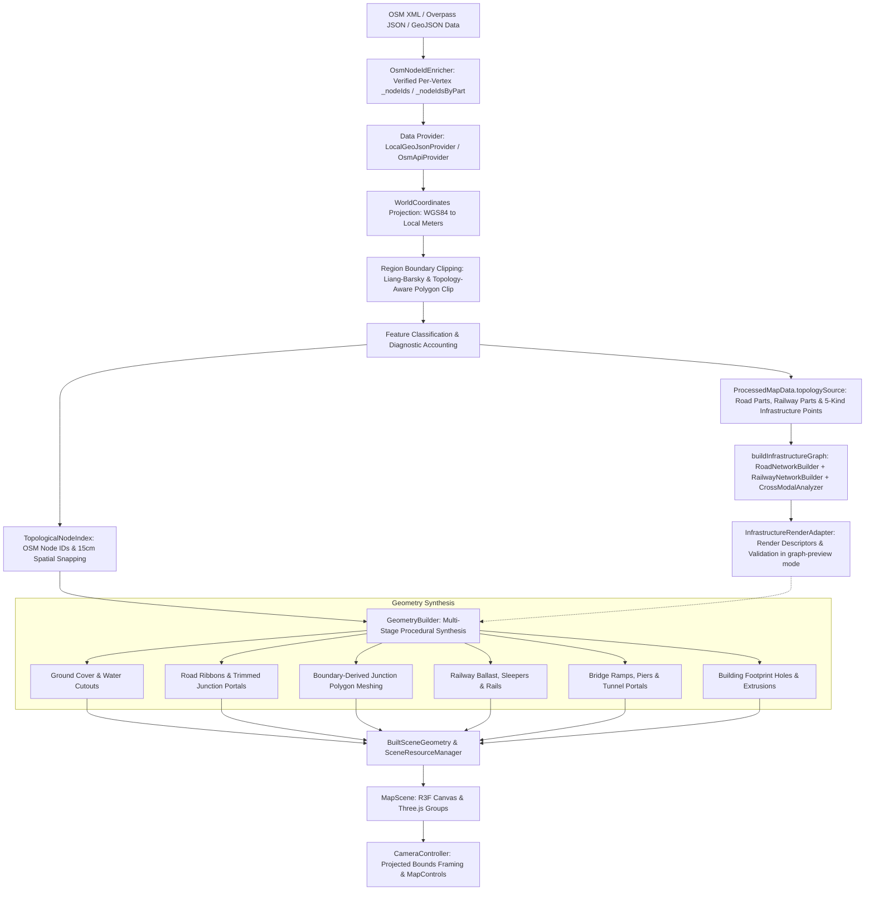

# System Architecture

## 1. System Overview

The 3D Map Viewer is a client-side WebGL application built on **React 19**, **TypeScript**, **Three.js (r186)**, and **React Three Fiber (v9)** with **Tailwind CSS**. It ingests vector geographic data from OpenStreetMap (OSM) via local GeoJSON bundles or remote Overpass API queries, transforms spherical coordinates to a local Euclidean Cartesian space (meters), synthesizes procedural 3D meshes for roads, junctions, buildings, railways, waterways, and land use, and displays them via an orthographic isometric camera with interactive navigation.

### Core Architectural Goals
- **High Visual Stability**: Eliminates z-fighting at ordinary at-grade intersections and coplanar ground surfaces using 2D Boolean clipping, boundary-derived junction meshing, and deterministic depth bias (`polygonOffset`).
- **Physical Elevation Model**: Establishes a uniform at-grade road baseline (`+0.050 m`) and reserves true geometric elevation changes for real grade-separated structures (bridges rising to `+2.850 m`, tunnels descending to `-2.0 m`).
- **Strict Bounded Region Pipeline**: Enforces axis-aligned bounding box clipping across all geometry types so geometry never bleeds beyond the queried geographic bounds.
- **Deterministic GPU Resource Lifecycle**: Centralizes geometry registration and disposal via `SceneResourceManager` to prevent memory leaks during camera reframing, theme changes, and region reloads.

---

## 2. Major Components & Responsibilities

| Subsystem | Primary Modules | Responsibilities |
| :--- | :--- | :--- |
| **Data Ingestion & Providers** | `src/world/MapDataProvider.ts` `src/world/LocalGeoJsonProvider.ts` `src/world/OsmApiProvider.ts` | Ingests GeoJSON or Overpass OSM data, clips polylines and polygons to the region bounding box, extracts raw OSM node IDs, and parses features into typed collections with provenance diagnostics. |
| **Feature Classification** | `src/types/MapFeature.ts` `src/world/FeatureCatalogue.ts` | Defines data structures for roads, buildings, railways, waterways, parks, and land-use. Resolves ambiguous OSM tags into concrete rendering categories. |
| **Coordinate Projection** | `src/world/WorldCoordinates.ts` | Converts WGS84 coordinates `[lon, lat]` into local metric Euclidean coordinates `[x, z]` centered around the dataset origin `(lon0, lat0)`. Provides haversine distance and inverse projection. |
| **Topological Indexing** | `src/world/TopologicalNodeIndex.ts` | Clusters road and railway endpoints within a 15 cm tolerance or resolves explicit OSM node IDs with deterministic tie-breaking. Enforces `layerScope` isolation so bridges and tunnels do not merge with at-grade roads. |
| **Infrastructure Topology & Graph Construction** | `src/world/infrastructure/topology/types.ts` `src/world/infrastructure/topology/OsmNodeIdEnricher.ts` `src/world/infrastructure/topology/RoadNetworkBuilder.ts` `src/world/infrastructure/topology/RailwayNetworkBuilder.ts` `src/world/infrastructure/topology/CrossModalAnalyzer.ts` `src/world/infrastructure/topology/InfrastructureGraph.ts` | Enriches converted Overpass/XML GeoJSON features with verified per-vertex OSM node IDs (`_nodeIds`, `_nodeIdsByPart`) and constructs pure-TypeScript OSMnx-style road and railway topology graphs (`RoadNetwork`, `RailwayNetwork`, `RailwayFlatCrossingRelation`, `LevelCrossingRelation`, `GradeTransitionRelation`, `GradeSeparatedCrossingRelation`, `InfrastructureGraph`) from non-destructive `ProcessedMapData.topologySource` records (`ADR-0009`). |
| **Graph-to-Renderer Adapter (`M2.3-E1`)** | `src/world/infrastructure/rendering/InfrastructureRenderAdapter.ts` | Pure, deterministic adapter converting `InfrastructureGraph` into render-ready road, railway, and cross-domain descriptors (`InfrastructureRenderDescriptorBundle`) with full source-feature lineage, contract validation, and independent `'legacy' \| 'graph-preview'` switches (`InfrastructureRenderOptions`). |
| **Procedural Geometry Generation** | `src/world/GeometryBuilder.ts` `src/world/BridgeAndTunnelBuilder.ts` `src/world/ElevationPolicy.ts` `src/world/infrastructure/railways/RailwayGeometryBuilder.ts` `src/world/infrastructure/railways/RailwayTopology.ts` `src/world/infrastructure/rendering/UvRibbonBuilder.ts` `src/world/infrastructure/rendering/InfrastructureShaderChunks.ts` | Synthesizes road ribbons, boundary-derived junction polygons with miter limits, extruded building prisms with courtyard holes, hybrid 3D/UV-ribbon railways with turnout bearer support, bridges with approach ramps, and 3D tunnel portals. |
| **Scene & Resource Management** | `src/world/SceneResourceManager.ts` `src/scene/MapScene.tsx` | Manages Three.js scene graphs, materials, instanced meshes, and immediate disposal of intermediate BufferGeometries during generation. |
| **Camera & Viewport Controls** | `src/scene/CameraController.tsx` | Controls the Three.js OrthographicCamera, computes bounding-box framing for rotated views, clamps near/far planes, and manages pan/zoom/tilt interactions. |
| **Geometry Validation & Diagnostics** | `src/world/ZFightingValidator.ts` `src/world/PlanarLayerValidator.ts` | Validates triangle coplanarity, positive-area road-vs-road overlaps, junction portal continuity, and non-self-intersection. |
| **Application UI** | `src/App.tsx` `src/components/AddressSearchModal.tsx` `src/styles/mapThemes.ts` | Provides theme selectors (Tactical, Blueprint, Minimal, Dark), dataset location pickers, feature inspection popovers, and diagnostic badges. |

---

## 3. Runtime Data Flow

The runtime pipeline flows monotonically from geographic data ingestion to WebGL rendering:

---

## 4. State & Resource Ownership

### Application State vs. Scene State
- **React State (`App.tsx`)**: Owns the active `mapData` (of type `ProcessedMapData`), active `themeId`, camera reset/frame signals, search modal visibility, and inspectable feature popup state.
- **Three.js Scene State (`MapScene.tsx` & `GeometryBuilder.ts`)**: Owns WebGL resources including `BufferGeometry`, `Material`, `Group`, and `Mesh` instances.
- **Geometry Lifecycle (`BuiltSceneGeometry`)**:
  - `buildScene()` compiles `ProcessedMapData` into grouped Three.js meshes.
  - All intermediate temporary geometries created during merging (e.g., individual road segment strips or individual building prisms) are tracked by `SceneResourceManager.registerIntermediateGeometry()` and immediately freed via `releaseIntermediateGeometry()`.
  - When a dataset is reloaded or the component unmounts, `BuiltSceneGeometry.dispose()` performs a single-pass disposal of all retained scene geometries and materials.

### Developer Tools & Reproduction Architecture (`TKT-009`)
- **Centralized Developer State (`App.tsx`, `DevToolsPanel.tsx`)**: Unifies rendering controls (`infrastructureRenderOptions`, `railwayPrototypeMode`), diagnostic overlays (`wireframe`, `showGraphOverlay`), spatial area selection (`isSpatialSelectActive`, `selectedBoxMeters`), and fixture navigation (`onLoadSwitchyard`, `onLoadPrinsFork`, etc.) into explicit application state without fractured state containers.
- **Reproduction Pipeline (`src/world/dev/ReproductionReport.ts`)**:
  - `extractConnectedOsmFeatures`: Isolates target OSM features (via click selection or 2D spatial box) along with immediate connected incident context sharing verified OSM node IDs, strictly preserving `_nodeIds` and coordinates without fabricating synthetic junctions.
  - `buildReproductionPackage`: Compiles issue metadata, active rendering configuration, camera pose, and GeoJSON `FeatureCollection` into a portable JSON package.
  - `validateReproductionPackage` & `LocalGeoJsonProvider.parseGeoJson`: Re-imports exported reports to reconstitute the exact dataset, camera position, and renderer options in-memory.

---

## 5. Architectural Boundaries

1. **UI vs. Renderer Boundary**: React components (`App.tsx`, `AddressSearchModal.tsx`) never directly manipulate Three.js buffer attributes or mesh vertex arrays. Communication happens through props passed into `MapScene` and standard event handlers (`onInspectFeature`).
2. **Provider vs. Geometry Boundary**: `MapDataProvider` outputs purely mathematical and semantic representations (`ProcessedMapData` containing metric coordinate arrays, metadata tags, bounding boxes, and non-destructive `topologySource` records). Providers do not create Three.js objects or materials.
3. **Topology & Adapter vs. Renderer Boundary (`ADR-0009`, `M2.3-E1`, `M2.3-E2`)**: `RoadNetworkBuilder`, `RailwayNetworkBuilder`, `CrossModalAnalyzer`, `buildInfrastructureGraph` (`src/world/infrastructure/topology/`), and `InfrastructureRenderAdapter` (`src/world/infrastructure/rendering/InfrastructureRenderAdapter.ts`) operate on pure TypeScript data structures with zero React, Three.js, renderer, or WebGL imports. Independent developer switches (`?topologyRoads=legacy|graph-preview|graph&topologyRailways=legacy|graph-preview`) select between the legacy renderer (`'legacy'`), descriptor validation (`'graph-preview'`), and graph-driven at-grade road & junction mesh synthesis (`roads: 'graph'` via `src/world/infrastructure/roads/GraphRoadGeometryBuilder.ts`), while railway rendering remains on `'legacy' | 'graph-preview'` until Stage E3 is separately authorized.
4. **Geometry vs. Camera Boundary**: `GeometryBuilder` constructs world-space meshes positioned relative to the dataset origin `(0, 0, 0)`. It exposes bounding boxes (`bounds`) to `CameraController.tsx`, which uses purely projective math to adjust orthographic zoom and target offsets.

---

## 6. Known Architectural Constraints

- **Client-Side Single-Threaded Processing**: All polygon clipping (`polygon-clipping`), triangulation (`THREE.ShapeUtils.triangulateShape`), and ribbon generation run synchronously on the main JavaScript thread. Large queries (> 5,000 features) must be budgeted carefully to avoid frame drops.
- **Bounded Local Coordinate Frame**: Projections use an equirectangular flat-Earth projection tangent to the dataset center `(originLon, originLat)`. Metric accuracy degrades as distance from the origin exceeds ~25 km; the viewer is optimized for urban neighborhood tiles up to ~5 km across.
- **Goalpost 2 Scope Boundary**: The active project scope is Goalpost 2: Infrastructure Topology, Railway Rendering, and Surface Markings. The architecture includes OSM-derived infrastructure connectivity and topology, including road and railway networks (with M2.1, M2.2, M2.3-A, M2.3-B, M2.3-C, M2.3-D, and M2.3-E1 complete and closed, M2.3-E2 implemented and pending project-owner review, and Stages E3–E5 requiring separate explicit project-owner approval). While infrastructure topology models connectivity that may provide a foundation for future pathfinding, this does not authorize implementation of gameplay movement, game-agent AI, physics, entity collision, or dynamic traffic simulation. Speculative streaming architectures and unrelated gameplay systems remain strictly out of scope.

## E2+ Architecture Addendum (2026-11-09)

The above junction-first pipeline describes **Legacy and E2**. The project owner selected **E2+ (`roads: 'graph-surface'`)** as the preferred *future* at-grade road rendering path, while `legacy` remains the production default. E2+ retains the unchanged OSM graph, grade metadata and provenance, but buffers full-width road centerlines into local rounded footprints and partitions overlapping at-grade areas by tier/class/ID-ordered Boolean subtraction. **No new junction polygon is constructed; only successfully validated visible geometry claims ownership.**

This does not change railways, bridges, tunnels, world projection or true graph connectivity. See [ADR-0010](./decisions/ADR-0010-surface-first-road-rendering.md), [E2+ technical design](./e2-plus-surface-first-road-rendering.md) and [Twente scaling roadmap](./road-rendering-roadmap.md).
