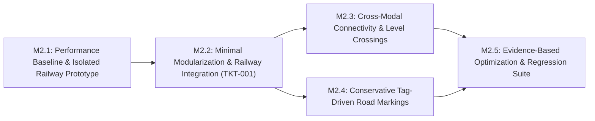

# Goalpost 2 — Infrastructure Rendering & Robustness: Approved Technical Proposal & Implementation Plan

> **Status**: Approved — Milestone 2.1 (`TKT-002`) Authorized for Execution  
> **Date**: 2026-10-31  
> **Scope**: Goalpost 2 — Infrastructure Rendering & Robustness  

---

## A. Current-State Assessment & Camera-Space Recalculation

### 1. Current Infrastructure Pipeline Overview
The 3D map viewer currently processes OpenStreetMap data through a synchronous, single-threaded pipeline:
1. **Ingestion & Clipping (`src/world/LocalGeoJsonProvider.ts`, `OsmApiProvider.ts`)**: Projects WGS84 coordinates into local Euclidean meters (`WorldCoordinates.ts`) and clips polylines (`Liang-Barsky`) and polygons (`Martínez-Rueda` + convex fallback) to `[-clipRadius, +clipRadius]`.
2. **Road Node Clustering (`src/world/TopologicalNodeIndex.ts`)**: Clusters road endpoints within a `0.15 m` tolerance or by explicit OSM `nodeIds`, scoped by a string `layerScope` (`veh`, `path`).
3. **Physical Elevation Policy (`src/world/ElevationPolicy.ts`)**: Assigns deterministic Y-elevations (`GROUND_COVER_SURFACE = +0.025 m`, `ROAD_SURFACE = +0.050 m`, `RAILWAY_BALLAST = +0.060 m`, `RAILWAY_SLEEPERS = +0.072 m`, `RAILWAY_RAILS = +0.085 m`, `BRIDGE_ROAD_DECK = +2.850 m`, `TUNNEL_DEPTH = -2.000 m`) and `polygonOffset` biases.
4. **Grade-Separated Profiles (`src/world/BridgeAndTunnelBuilder.ts`, 696 lines)**: Generates 3D longitudinal bridge profiles (`buildBridgeProfile3D`), abutment headwalls for short spans (`< 5.0 m`), bridge decks, piers, parapets, and 3D tunnel portals (`generateTunnelPortalAndTraceGeometries`).
5. **Scene Synthesis (`src/world/GeometryBuilder.ts`, 6,368 lines)**: Synthesizes all 9 scene layers (ground, water, parks, landuse, railways, roads/junctions, barriers, instanced trees/furniture, and buildings) and tracks GPU buffers via `SceneResourceManager.ts`.

---

### 2. Exact Camera Configuration & Recalculated Screen-Space Visibility
To ground our railway and road-marking rendering decisions in actual viewport math rather than rough estimates, we inspect `src/scene/CameraController.tsx` and `src/app/App.tsx`:

- **Projection**: `THREE.OrthographicCamera` (`makeDefault`) with frustum bounds `[-width/2, +width/2] × [-height/2, +height/2]` in CSS pixels.
- **Polar Tilt Angle ($\theta_{\text{tilt}}$)**: Fixed at `DEFAULT_TILT_ANGLE = Math.PI / 3.25` ($\approx 55.38^\circ$ from vertical $+Y$), giving:
  $$\cos(55.38^\circ) \approx 0.5681 \quad (\text{foreshortening along view azimuth on horizontal } XZ \text{ plane})$$
  $$\sin(55.38^\circ) \approx 0.8230 \quad (\text{vertical } Y \text{ projection factor onto screen } Y)$$
- **Configured Zoom Range (`src/app/App.tsx` lines 404–405)**:
  - `minZoom = 0.15` ($0.15\text{ CSS px/m}$ perpendicular to view)
  - `Default Framed Region Zoom` (`computeProjectedBoundsFraming` on a ~900 m neighborhood tile at $1200 \times 800$): $\text{zoom} \approx 0.85\text{–}1.35\text{ CSS px/m}$
  - `maxZoom = 8.0` ($8.0\text{ CSS px/m}$ perpendicular to view)

#### Correction of Sleeper Elevation Difference ($\Delta Y = 0.012\text{ m}$, not $0.12\text{ m}$)
In `src/world/ElevationPolicy.ts` (lines 90–92):
- `RAILWAY_BALLAST = 0.060 m`
- `RAILWAY_SLEEPERS = 0.072 m` $\rightarrow$ **Vertical step above ballast is $\Delta Y = 0.012\text{ m}$ ($12\text{ mm}$)**, not $0.12\text{ m}$.
- `RAILWAY_RAILS = 0.085 m` $\rightarrow$ **Vertical step above sleepers is $\Delta Y = 0.013\text{ m}$ ($13\text{ mm}$)**.

Using the exact projection formulas from `CameraController.tsx`:
- **Horizontal dimension $D$ perpendicular to view azimuth**: $P_{\perp} = D \times \text{zoom}$ (CSS px)
- **Horizontal dimension $D$ parallel to view azimuth (foreshortened)**: $P_{\parallel} = D \times \text{zoom} \times \cos(55.38^\circ) = 0.5681 \times D \times \text{zoom}$ (CSS px)
- **Vertical height $\Delta Y$**: $P_{Y} = \Delta Y \times \text{zoom} \times \sin(55.38^\circ) = 0.8230 \times \Delta Y \times \text{zoom}$ (CSS px)

| Railway Feature Dimension (Meters) | Far Zoom (`zoom = 0.5`) | Default Framed (`zoom = 1.0`) | Medium Zoom (`zoom = 3.0`) | Max Close Zoom (`zoom = 8.0`) | Hypothetical Expanded Close (`zoom = 16.0`) |
| :--- | :--- | :--- | :--- | :--- | :--- |
| **Sleeper Step $\Delta Y = 0.012\text{ m}$** | `0.005 px` | `0.010 px` | `0.030 px` | **`0.079 px`** | `0.158 px` |
| **Real Timber Thickness $\Delta Y = 0.160\text{ m}$** | `0.066 px` | `0.132 px` | `0.395 px` | **`1.053 px`** | `2.107 px` |
| **Tie Spacing Period ($1.45\text{ m}$) $[P_{\parallel} \text{ to } P_{\perp}]$** | `0.41 – 0.73 px` | **`0.82 – 1.45 px`** | `2.47 – 4.35 px` | `6.59 – 11.60 px` | `13.18 – 23.20 px` |
| **Sleeper Thickness ($0.40\text{ m}$) $[P_{\parallel} \text{ to } P_{\perp}]$** | `0.11 – 0.20 px` | **`0.23 – 0.40 px`** | `0.68 – 1.20 px` | `1.82 – 3.20 px` | `3.64 – 6.40 px` |
| **Sleeper Width ($2.48\text{ m}$) $[P_{\parallel} \text{ to } P_{\perp}]$** | `0.70 – 1.24 px` | `1.41 – 2.48 px` | `4.23 – 7.44 px` | `11.27 – 19.84 px` | `22.54 – 39.68 px` |
| **Track Inner Gauge ($1.435\text{ m}$ face-to-face) $[P_{\parallel} \text{ to } P_{\perp}]$** | `0.41 – 0.72 px` | `0.82 – 1.44 px` | `2.45 – 4.31 px` | `6.52 – 11.48 px` | `13.04 – 22.96 px` |
| **Physical UIC-60 Rail Head ($0.072\text{ m}$) $[P_{\parallel} \text{ to } P_{\perp}]$** | `0.02 – 0.04 px` | `0.04 – 0.07 px` | `0.12 – 0.22 px` | `0.33 – 0.58 px` | `0.65 – 1.15 px` |
| **Visual Exaggerated Rail Width ($0.20\text{ m}$) $[P_{\parallel} \text{ to } P_{\perp}]$** | `0.06 – 0.10 px` | **`0.11 – 0.20 px`** | `0.34 – 0.60 px` | `0.91 – 1.60 px` | `1.82 – 3.20 px` |

#### Canonical Railway Dimension Specification (`RAILWAY_DIMENSION_SPEC`)
To eliminate previous inconsistencies (`0.22 m` vs. `0.26 m` rail widths, and inner gauge vs. centerline offset), we establish an explicit three-tier distinction between **physical dimensions**, **world-space visual exaggerations**, and **shader-space filter widths**:
- **Physical Standard Gauge (`innerGaugeMeters = 1.435 m`)**: The distance between the **inner faces** of the two rails. With a physical UIC-60 rail head width of `0.072 m`, the physical center-to-center rail spacing is `1.435 m + 0.072 m = 1.507 m` (`±0.7535 m` from track centerline).
- **World-Space Visual Rail Width (`visualRailWidthMeters = 0.20 m` standard rail, `0.16 m` tram)**: Because a physical `0.072 m` rail head is only `0.33–0.58 px` wide even at `maxZoom = 8.0`, rendered rails use an explicit world-space visual width of `0.20 m` (`0.16 m` for tram). To preserve the true `1.435 m` clear inner gauge between the inner faces of the rendered rails, the **visual rail center-to-center spacing** is `innerGaugeMeters + visualRailWidthMeters = 1.435 m + 0.20 m = 1.635 m` (`±0.8175 m` from track centerline).
- **Shader-Space Filter Width**: Derived per-fragment from `fwidth(v)` (`minFilterWidthPx = 1.35 px`) with proportional contrast/energy attenuation so sub-pixel rails never bloom at medium/far zoom.

#### Key Takeaways from the Camera Math
1. **At Default Framed Zoom (`zoom ≈ 1.0`), Sleeper Periodicity Is Already Sub-Nyquist**:
   - A `1.45 m` sleeper period projects to `0.82–1.45 CSS pixels` (below the `2.0 px` Nyquist sampling threshold). Any un-filtered discrete sleeper geometry—whether merged `BufferGeometry` quads or `THREE.InstancedMesh`—will alias at default framing unless filtered or faded out.
2. **At Current `maxZoom = 8.0`, Planar Sleeper Footprint Is Distinct (`1.8–3.2 px` by `11.3–19.8 px`), While Vertical $\Delta Y = 0.012\text{ m}$ Is Sub-Pixel (`0.08 px`)**:
   - Under the current `maxZoom = 8.0`, the $0.012\text{ m}$ elevation offset provides depth-buffer separation rather than visible vertical side-wall parallax. Even a full $0.16\text{ m}$ 3D timber box has only a $\sim 1.05\text{ px}$ vertical side wall at `zoom = 8.0`, though it would reach $\sim 2.1\text{ px}$ if `maxZoom` is raised to `16.0`.
   - Whether 3D/instanced close-zoom sleepers provide a tangible visual advantage over normal/bevel-shaded procedural sleepers at `zoom = 5.0–8.0` (or `16.0`) is therefore an empirical question that we will test directly in the **M2.1 prototype**.

---

## B. Section 1 — Railway Rendering: Deep-Dive Validation & Prototype Design

### 1. Pattern Anti-Aliasing (`fwidth`) vs. Actual Railway Topology
We must maintain a strict conceptual boundary between two orthogonal problems:

- **What `fwidth()` does (Signal Filtering within a Single Ribbon)**:
  - Given continuous ribbon coordinates $(u, v)$ where $u$ is arc length and $v$ is lateral offset, hardware screen-space derivatives (`fwidth(u) = |du/dx| + |du/dy|`) approximate the local pixel footprint of one world meter in a $2 \times 2$ fragment quad.
  - This allows analytic box-filtering of high-frequency repeating patterns (such as `1.45 m` sleepers) so that contrast attenuates smoothly as the pattern approaches $2\text{ pixels/period}$.
- **What `fwidth()` does NOT do (Track Topology & Ribbon Intersection)**:
  - `fwidth()` is purely local to the currently rasterizing triangle of a single track ribbon. It has **zero awareness** of another track ribbon diverging at a switch, crossing at a frog, or running parallel in a station throat.
  - Moreover, `fwidth()` has inherent limitations:
    1. **Coarse $2 \times 2$ quad granularity** across steep miter seams where tangent direction changes abruptly at polyline vertices.
    2. **Anisotropic grazing blur** when a track runs nearly parallel to the camera view azimuth ($P_{\parallel} = 0.568 \times P_{\perp}$), causing sleepers to fade out earlier on tracks aligned with the camera than on tracks perpendicular to the camera.
    3. **Zero handling of multi-ribbon compositing**: How two independent ribbons combine in the framebuffer is governed entirely by **geometry topology, depth values, and stencil/blending rules**, not by `fwidth()`.

---

### 2. How Independent Railway Ribbons Interact at Diverging Switches (Critique of Stencil Write-Once)

In our initial draft, we suggested rendering a combined `Ballast_And_Sleepers` ribbon (`width = 3.5 m`) with `stencilWrite: true` (`stencilRef = 14`). **Upon closer geometric inspection, a single stencil-locked `Ballast_And_Sleepers` pass has a critical flaw that would suppress legitimate turnout geometry:**

- On a standard `3.5 m`-wide track ribbon (`|v| <= 1.75 m`), the wooden sleepers only occupy the inner `2.48 m` (`|v| <= 1.24 m`), while the outer `0.51 m` on each side (`1.24 m < |v| <= 1.75 m`) is bare crushed-stone ballast shoulder.
- At a diverging turnout, `Track B` branches off `Track A` at angle $\theta \approx 5^\circ\text{–}8^\circ$. As `Track B`'s centerline separates from `Track A` by $d_{\text{center}} \in [0.2\text{ m}, 1.75\text{ m}]$, **`Track B`'s sleepers (`|v_B| <= 1.24 m`) and rails (`|v_B| = 0.7175 m`) pass directly through `Track A`'s outer gravel shoulder (`1.24 m < |v_A| <= 1.75 m`)**.
- If `Track A`'s combined ribbon writes `stencilRef = 14` across its entire `3.5 m` width (`|v_A| <= 1.75 m`), it locks the outer `0.51 m` gravel shoulder as "already claimed." When `Track B` renders second, `Track B`'s sleepers and inner rail inside `1.24 m < |v_A| <= 1.75 m` are rejected by the stencil buffer—**cutting a `0.51 m` gravel trench right through the turnout's sleepers!**

#### Corrected Multi-Component Layering Rule (Hierarchy by Physical Material, Not by Track)
For two independent track ribbons (`Track A` and `Track B`) to composite without suppressing turnout sleepers or rails, **compositing priority must be ordered by physical sub-component (`Rails > Sleepers > Ballast`), never by whole-track ribbon**:

1. **Sub-Layer 1 — Ballast Bed (`Y = +0.060 m`, `renderOrder = 14`, `stencilRef = 14`)**:
   - Covers `|v| <= ballastHalfWidth` (`1.75 m`).
   - Overlapping ballast beds from `Track A` and `Track B` union cleanly into a single continuous gravel switch bed at `+0.060 m` (`stencilRef = 14` prevents any double-shading).
2. **Sub-Layer 2 — Sleeper Bed (`Y = +0.072 m`, `renderOrder = 15`, `stencilRef = 15`)**:
   - Covers **only** `|v| <= sleeperHalfWidth` (`1.24 m`).
   - Because all Sub-Layer 2 sleepers render *after* (and $12\text{ mm}$ above) Sub-Layer 1 ballast with a distinct `stencilRef = 15`, **`Track B`'s sleepers always draw on top of `Track A`'s outer ballast shoulder (`1.24 m < |v_A| <= 1.75 m`)**.
   - Where `Track A`'s sleeper zone (`|v_A| <= 1.24 m`) and `Track B`'s sleeper zone (`|v_B| <= 1.24 m`) overlap inside the switch throat, how they interact depends on whether sleepers are rendered as discrete/alpha-discarded ties or a continuous shader bed (analyzed below in Subsection 3).
3. **Sub-Layer 3 — Steel Rails (`Y = +0.085 m`, `renderOrder = 16`, `stencilRef = 16`)**:
   - Covers **only** the physical rail heads `||v| - gaugeHalf| <= railHalfWidth` (`0.7175 m ± 0.11 m`; pixels outside the rail heads are either not part of the mesh or `discard`ed in the fragment shader).
   - Because Sub-Layer 3 renders at `Y = +0.085 m` with `stencilRef = 16`, **`Track B`'s rails always draw cleanly over both `Track A`'s ballast and `Track A`'s sleepers**, and where two rails cross at a frog, `stencilRef = 16` ensures the intersection pixel is shaded once without brightness blooming.

---

### 3. Sleeper Coherence Across Branch Tracks (Switch Throats)
What happens where `Track A`'s sleeper zone (`|v_A| <= 1.24 m`) and `Track B`'s sleeper zone (`|v_B| <= 1.24 m`) overlap in 2D?

Let `Track A` (mainline) and `Track B` (turnout) share switch node $P_0$ with identical arc-length phase $u_A(P_0) = u_B(P_0) = \phi_0$:
- **Case 1: Fragment-Discarded Sleeper Quads (Shader `discard` between ties, `stencilRef = 15` written only on wood pixels)**:
  - If `Track A` only writes `stencilRef = 15` on wood tie pixels (`u_mod < 0.40 m`) and `discard`s ballast gap pixels (`0.40 m <= u_mod < 1.45 m`), then wherever `u_B` drifts out of phase with `u_A` ($\Delta u = L(1 - \cos\theta)$), `Track B`'s wood ties will draw *inside* `Track A`'s ballast gaps! That recreates the exact interleaved "solid wood floor" clutter seen in discrete 3D sleeper meshes.
- **Case 2: Continuous Sleeper-Zone Ownership (`|v| <= 1.24 m` claims `stencilRef = 15` for both tie and inter-tie gap)**:
  - If the `Sleeper_Zone` ribbon (`width = 2.48 m`, `|v| <= 1.24 m`) writes `stencilRef = 15` across its entire `2.48 m` width (evaluating wood vs. inter-tie gravel color in the shader):
    - Inside `|v_A| <= 1.24 m`, `Track A` (the through-mainline, sorted first) completely owns the sleeper pattern (`u_A`). `Track B` cannot interleave ties inside `Track A`'s sleeper footprint.
    - Immediately outside `|v_A| = 1.24 m` (for `1.24 m < dist_to_A <= dist_to_B + 1.24 m`), `Track B` owns the sleeper pattern (`u_B`).
    - Because $u_A(P_0) = u_B(P_0)$ at the switch node and $\cos\theta \approx 0.994$ for a $6^\circ$ switch, over the first $15\text{ m}$ of the turnout where `Track B` widens the sleeper bed from `2.48 m` to `4.0 m`, the phase difference $|u_A - u_B|$ at the seam (`|v_A| = 1.24 m`) is only:
      $$\Delta u \approx 15\text{ m} \times (1 - \cos 6^\circ) + 1.24\text{ m} \times \sin 6^\circ \approx 0.08\text{ m} + 0.13\text{ m} = 0.21\text{ m}$$
    - Even more importantly, in the M2.1 prototype we can test **radial / shared-tangent phase projection** at switch throats (or longitudinal UV warping at the switch vertex) so `u_B` matches `u_A` along the `|v_A| = 1.24 m` seam within $< 0.05\text{ m}$, making the mainline sleeper and turnout sleeper extension visually form a single continuous long switch bearer across the throat.

---

### 4. Frogs, Switch Blades, and Rail Crossings
OpenStreetMap represents railways as 1D topological centerlines (`railway=rail`) that meet at a single shared node $P_0$. When we offset each centerline by $\pm\text{gauge}/2$ ($\pm 0.7175\text{ m}$):

1. **At the Switch Toe ($P_0$) — Switch Blades**:
   - At $P_0$, `Track B` diverges from `Track A` at angle $\theta$.
   - For a right-hand turnout, `Track B`'s left (inner) rail starts at $+0.7175\text{ m}$ (coincident with `Track A`'s left stock rail) and curves向右 toward `Track A`'s right rail, while `Track B`'s right (outer) rail starts at $-0.7175\text{ m}$ (coincident with `Track A`'s right stock rail) and curves outward into the diverging branch.
   - **Visual artifact to test in M2.1**: In reality, a switch blade tapers to a knife edge against the stock rail over the first $3\text{–}5\text{ m}$. If both rails are rendered at full `0.22 m` width right from $P_0$, the inner switch blade and stock rail form a thick double-width bar for the first $2\text{ m}$. In the M2.1 prototype, we will test a simple vertex/UV attribute (`aSwitchTaper` over the first $3.0\text{ m}$ of a branch endpoint at a degree-3+ switch node) that tapers the inner diverging rail width from $0.0\text{ m}$ to $0.22\text{ m}$ where it peels away from the stock rail.
2. **At the Frog ($L_{\text{frog}} \approx \frac{1.435\text{ m}}{\sin\theta}$) — Rail Crossing**:
   - At distance $L_{\text{frog}}$ (typically $10\text{–}18\text{ m}$ from $P_0$), `Track B`'s inner rail crosses `Track A`'s outer rail in a clean $X$-intersection.
   - By keeping both rails continuous across the frog (rather than clipping `Track B`'s polyline inside `Track A`'s gauge as `resolveRailPolylineClearance` did) and rendering Sub-Layer 3 (`Rails`) with `stencilRef = 16`, the $X$-crossing frog renders with zero gaps, zero dogleg kinks, and zero additive brightness.

---

### 5. Complex Multi-Track Station Throats
In dense station throats (e.g., 6–12 parallel tracks at $3.8\text{ m–}4.2\text{ m}$ center-to-center spacing connected by ladder crossovers and scissors crossings):
1. **Ballast Yard Coalescence**:
   - Adjacent `3.5 m` ballast ribbons (`Sub-Layer 1`, `stencilRef = 14`) touch or overlap along their outer gravel shoulders, merging into a continuous crushed-stone station yard apron at `Y = +0.060 m`.
2. **Ladder Crossovers & Compound Switches**:
   - Because a ladder track crosses multiple parallel tracks sequentially, each switch node is degree 3 or 4. Under the 3-sub-layer stencil/depth hierarchy (`Ballast 14 < SleeperZone 15 < Rails 16`), through-mainlines claim their straight `2.48 m` sleeper beds first, crossover tracks fill the diagonal sleeper bridges between parallel tracks (`1.24 m < |v_main| <= 2.0 m`), and all crossing rails render cleanly on top at `+0.085 m`.
3. **Avoiding Multi-Track Luminance Blooming at Medium/Far Zoom**:
   - The screenshots from `TKT-001` show a 6-track station throat turning into a bright white band at medium zoom. That occurred because `applyRibbonMinScreenWidthShader` expanded all 12 rails in vertex space to $\ge 1.5\text{ px}$ each while keeping 100% rail brightness, so 12 rails $\times 1.5\text{ px}$ completely obliterated the dark ballast between them.
   - **Fix**: Never expand rail geometry in vertex space beyond its physical metric width without proportionally attenuating its fragment contrast (`opacity / mix factor = clamp(physicalWidthPx / minFilterWidthPx, 0.25, 1.0)`). This preserves total energy (constant integrated luminance per unit area) across zoom levels so a 10-track station throat never blooms brighter than a single track at close zoom.

---

### 6. Experimental Prototype Design for M2.1: Procedural Ribbon vs. Hybrid Close-Zoom 3D Geometry

Rather than assuming upfront whether pure procedural ribbons or a hybrid 3D/procedural LOD system is superior at close zoom, **Milestone 2.1 will implement an isolated, inspectable prototype (`RailwayPrototypeCompare`)** that evaluates two candidates across real station-throat and switch fixtures:

| Dimension | Candidate A: Pure 3-Sub-Layer Procedural UV Ribbon | Candidate B: Hybrid Close-Zoom 3D / Instanced Sleepers + Med/Far Procedural Ribbon |
| :--- | :--- | :--- |
| **Close Zoom (`zoom > 4.5 px/m`)** | 3 flat UV-ribbon sub-layers (`Ballast +0.060 m`, `SleeperZone +0.072 m` with procedural bevel normals, `Rails +0.085 m`). | Extruded/instanced 3D sleeper boxes (`ΔY = 0.04 m` or `0.012 m`) and 3D rail profiles at close zoom, cross-fading to Candidate A below `zoom = 4.5 px/m`. |
| **Medium / Far Zoom (`zoom <= 4.5 px/m`)** | Same geometry; fragment shader analytically box-filters sleeper contrast (`fwidth(u)`) and energy-conserving rail coverage (`fwidth(v)`). | Switches/fades to Candidate A procedural UV ribbons. |
| **Switch Throat Handling** | Continuous `SleeperZone` (`stencilRef = 15`) automatically extends sleepers under diverging rails outside mainline bed. | Requires either custom variable-length switch bearer instances at close zoom or falling back to Candidate A inside switch throats. |
| **Key Hypothesis to Test in M2.1** | Does procedural normal/bevel shading on `SleeperZone` look just as convincing at `zoom = 8.0` (where $\Delta Y = 0.012\text{ m}$ is $0.08\text{ px}$) without any LOD transition pop? | Does real 3D sleeper/rail geometry at close zoom justify the added dual-representation memory and switch-throat transition complexity? |

**Decision Gate at End of M2.1**: Both candidates will be visually inspected in the browser on straight tracks, curved segments, single turnouts, scissors crossovers, and a multi-track station throat across all 4 themes before integrating the winning approach in M2.2.

---

## C. Section 2 — Architecture: Minimal, Justified Modularization in M2.2

### 1. Avoiding Premature Broad Refactoring
We agree that extracting all infrastructure types (roads, bridges, tunnels, barriers) before validating the railway renderer introduces unnecessary churn.

Therefore, in **Milestone 2.2**:
- **What we extract**:
  1. `src/world/infrastructure/rendering/UvRibbonBuilder.ts` — Shared continuous 2D/3D UV-ribbon geometry builder (`[u = arcLengthMeters, v = signedLateralMeters]`).
  2. `src/world/infrastructure/rendering/InfrastructureShaderChunks.ts` — Shared derivative-based filtering and energy-conserving line primitives.
  3. `src/world/infrastructure/railways/RailwayTopology.ts` — Mainline chaining (`sortRailwaysMainlineFirst`) and connected arc-length phase propagation (`computeRailwaySleeperPhases`).
  4. `src/world/infrastructure/railways/RailwayGeometryBuilder.ts` — The validated railway geometry and material pipeline from M2.1.
- **What stays in place during M2.2**:
  - `src/world/BridgeAndTunnelBuilder.ts` remains in its existing module (`RailwayGeometryBuilder` imports `buildBridgeProfile3D` and `generateBridgeStructureGeometries` directly from it).
  - At-grade road synthesis, road junction meshing, path Boolean clipping, and barrier generation remain in `src/world/GeometryBuilder.ts` untouched during M2.2.
  - Road marking helpers (`RoadMarkingBuilder.ts`) and cross-modal topology (`InfrastructureGraph.ts`) are introduced only in **M2.3** and **M2.4** when those features are actively built.

### 2. Revised Modularity Quality Criteria (No Line-Count Targets)
We drop "lines of code removed from `GeometryBuilder.ts`" as an acceptance criterion. Instead, M2.2 architectural quality is measured by:
1. **Single-Responsibility Isolation**: `GeometryBuilder.ts` contains zero railway-specific spatial indices, sleeper phase maps, or shader `onBeforeCompile` hooks; it invokes `buildRailwayInfrastructure(...)` via a single typed interface.
2. **Independent Unit Testability**: `UvRibbonBuilder`, `RailwayTopology`, and `RailwayGeometryBuilder` can be instantiated and tested in isolation (`src/world/RailwayRendering.test.ts`) without constructing a full `ProcessedMapData` scene or mocking unrelated building/road stages.
3. **Zero Resource or Raycast Coupling Regressions**: `faceRanges` feature inspection and `SceneResourceManager` disposal contracts remain 100% intact.

---

## D. Section 3 — InfrastructureGraph: Preserving Domain-Specific Connectivity

To support road junctions, railway switches, bridge/tunnel transitions, and road–railway level crossings without conflating distinct transport networks, `InfrastructureGraph` (`M2.3`) will enforce a strict separation between **Topological Network Connectivity**, **Physical Grade Transitions**, and **Spatial Cross-Modal Interactions**.

### 1. Taxonomy of Graph Relationships

| Relationship Class | Edge / Node Type | Domain Scope | Physical vs. Topological vs. Spatial | Downstream Geometry Action |
| :--- | :--- | :--- | :--- | :--- |
| **1. Intra-Modal Network Connectivity** | `road_junction_node` | Roads only (`veh` or `path`, same `layer`, `!isBridge`, `!isTunnel`) | **Topological & Physical**: Shared OSM `nodeId` (or $\le 0.15\text{ m}$ coordinate fallback at endpoints/split interior nodes) | Trim incoming road ribbons by intersection envelope; synthesize coplanar `JunctionPolygon` at `ROAD_SURFACE = +0.050 m`. |
| **2. Intra-Modal Network Connectivity** | `railway_switch_node` | Railways only (`rail`, `tram`, `narrow_gauge`, same `layer` & bridge state) | **Topological & Physical**: Shared OSM `nodeId` (or $\le 0.15\text{ m}$ endpoint fallback) | Chain collinear opposite-tangent ways into continuous mainlines; propagate arc-length phase `u`; apply switch-blade inner rail taper. |
| **3. Physical Grade Transition** | `road_grade_transition` `railway_grade_transition` | Same mode (`road->road` or `rail->rail`) transitioning between `at_grade (layer 0)` and `bridge` or `tunnel` | **Topological & Physical Vertical Boundary**: Shared OSM `nodeId` (or $\le 0.25\text{ m}$ endpoint fallback) | Lock the `at_grade` way's end portal (`left`, `right`, `y`) to the exact start portal of `buildBridgeProfile3D` or `generateTunnelPortalAndTraceGeometries`; suppress round end-cap. |
| **4. Cross-Modal Level Crossing** | `road_railway_level_crossing` | At-grade Road (`layer = 0`) $\times$ At-grade Railway (`layer = 0`) | **Physical Surface Interaction, Non-Traversable Across Modes**: High-confidence when backed by explicit shared `railway=level_crossing` / `railway=crossing` node; inferred 2D segment intersections (`layer = 0`, `!isBridge`, `!isTunnel`) are treated as **lower-confidence candidates** requiring additional validation (shared topological node or verified absence of missing bridge/tunnel tags) rather than automatically modifying surface geometry. | **Does NOT create a road junction or split the road/rail network.** Records crossing window `[uStart, uEnd]` on high-confidence level crossings to render a flush paved crossing apron (`+0.082 m` rail head flush with asphalt) and suppress exposed ballast/sleepers across the carriageway. |
| **5. Grade-Separated Crossing** | `grade_separated_overpass` | Any two ways where `layer_A !== layer_B` or `isBridge/isTunnel` differs | **Purely Spatial (2D projection only)**: Physically separated in 3D ($> 2.8\text{ m}$ vertical clearance) | **Zero topological or surface interaction.** Each feature renders continuously at its own elevation tier. |
| **6. Unconnected Coplanar Overlap** | `coplanar_spatial_overlap` | E.g., an unsplit `footway` crossing a vehicular `residential` street without a shared node | **Purely Spatial (2D overlap)**: No topological junction node | Resolved in 2D via carriageway-priority Boolean subtraction (`polygonClipping.difference`) so the path breaks cleanly at the road curbs. |

---

### 2. Why a Road Crossing a Railway Must Never Become a Road Junction
If a road and a railway share an OSM node (`railway=level_crossing`) and were fed into a shared junction solver:
- The road junction solver (`JunctionResolver`) would treat the railway branches as incoming road arms, trimming the road back and synthesizing an asphalt polygon that flares out along the railway tracks, or splitting the continuous road ribbon so its lane markings and UV parameterization break.
- Instead, in `InfrastructureGraph`:
  - The **Road Subgraph** and **Railway Subgraph** maintain completely separate adjacency lists.
  - A shared OSM node between a road way and a railway way is registered in the **Cross-Modal Interaction Index** as a `LevelCrossingInteraction` referencing `(roadFeatureId, roadArcLengthU, railwayFeatureId, railwayArcLengthU, crossingAngle, roadWidth, trackGauge)`.
  - Both the road ribbon and the railway rails remain continuous across the crossing; only the surface material treatment inside the intersection polygon changes (replacing raised gravel ballast and exposed wooden sleepers with a flush asphalt/concrete crossing pad around the rails).

### 3. Preserving Coordinate-Based Fallback Handling
While live Overpass queries provide exact `nodeIds` on ways, custom GeoJSON uploads and region-boundary-clipped segments may lack `nodeIds` at clipped or synthesized vertices. `InfrastructureGraph` will preserve `TopologicalNodeIndex`'s two-tier resolution:
1. **Primary**: Exact canonical OSM `nodeId` match within the same domain and vertical scope (`mode + layer + isBridge + isTunnel`).
2. **Fallback**: 2D spatial-hash grid clustering within `0.15 m` for intra-modal endpoints and `0.25 m` for at-grade-to-bridge/tunnel transition endpoints when `nodeId` is absent.

---

## E. Section 4 — Road Markings: Conservative Source-Data Policy (`M2.4`)

OpenStreetMap tags vary widely in completeness. Inferring elaborate road markings solely from `highway=primary` or `highway=residential` risks drawing centerlines down narrow single-track streets or placing stop lines inside roundabouts and minor driveways.

We revise **Milestone 2.4** around a strict **Conservative Source-Data Interpretation Policy**:

### 1. Explicitly Justified Markings vs. Excluded Approximations

| Marking Feature | Required OSM Evidence to Render | Guardrails & Suppression Rules | Status in M2.4 |
| :--- | :--- | :--- | :--- |
| **1. Longitudinal Center & Lane Dividers** | Explicit `lanes >= 2` (provided `lane_markings` is not `no`), OR explicit positive marking tags (`lane_markings=yes`, `marked_lanes=yes`, `divider=yes`). **Note**: An absent `lane_markings` tag does *not* by itself count as positive evidence of markings on untagged roads; when `lane_markings` is absent, explicit `lanes >= 2` + width guardrails are required. Respects `oneway=yes\|-1` and `lanes:forward` / `lanes:backward`. | **Never** infer lane dividers solely from `highway` class when `lanes` is untagged, and never treat `lane_markings != no` alone as positive evidence. **Minimum Width Guardrail**: Suppress all longitudinal lane dividers if rendered carriageway width is `< 5.5 m` (or `< 2.75 m` per lane). Terminate `1.5 m` before junction portals. | **Included in M2.4** |
| **2. Pedestrian Zebra Crossings** | Explicit OSM node with `highway=crossing` + explicit zebra/marked surface evidence (`crossing=zebra\|marked` or `crossing:markings=yes\|zebra\|lines`, excluding `crossing=unmarked\|no\|informal`). **Note**: `crossing=traffic_signals` indicates traffic signal control, *not* zebra stripes—signalized crossings only render zebra stripes if accompanied by explicit `crossing:markings=zebra\|lines\|yes`. | Only render when snapped to a vehicular carriageway (`motorway` through `residential` / `unclassified`) with effective width $\ge 4.0\text{ m}$ and located outside interior junction polygon centroids. | **Included in M2.4** |
| **3. Dedicated Cycleway Surface / Edge Markings** | Explicit `highway=cycleway` way, OR vehicular road with explicit `cycleway=lane`, `cycleway:right=lane`, `cycleway:left=lane`, or `cycleway:both=lane`. | Only render side cycle-lane stripes on vehicular roads when effective road width is $\ge 6.5\text{ m}$. | **Included in M2.4** |
| **4. Junction Stop Lines (`stop_bar`)** | Requires exact stop position (`highway=stop` / `highway=give_way` node with `direction=*` or `traffic_signals:direction=*`). | **Deferred**: Placing stop lines heuristically at trimmed junction portals creates false stop bars at unsignalized intersections, T-junction through-lanes, and minor service roads. | **Deferred beyond Goalpost 2** |
| **5. Lane Turn Arrows (`turn:lanes`)** | Requires `turn:lanes` + exact lane geometry near approaches. | **Deferred**: Sparse OSM coverage and high risk of distortion on curved or short road segments. | **Deferred beyond Goalpost 2** |

---

## F. Section 5 — Performance Strategy: Benchmark First, Optimize on Evidence

### 1. Moving Baseline Collection to Milestone 2.1
Before modifying railway rendering or extracting modules, **Milestone 2.1** will establish a reproducible performance baseline and documented benchmark environment. Quantitative optimization targets for **Milestone 2.5** will be derived as concrete percentage improvements or regression bounds relative to this measured M2.1 baseline, eliminating premature hardcoded millisecond targets.

### 2. Reference Datasets & Documented Benchmark Environment
All benchmarks will be recorded against three standardized reference datasets with hardware/browser environment metadata logged in the benchmark report:
1. **Dataset 1 — Bundled Urban Neighborhood (`public/map.geojson`)**: Standard repository baseline dataset.
2. **Dataset 2 — Multi-Track Station Throat & Switchyard Fixture (`RailwayTestFixtures`)**: Representative railway junction topology containing straight/curved tracks, single turnouts, scissors crossovers, and a 6-track station throat.
3. **Dataset 3 — High-Density Urban Stress Fixture**: High feature-count urban tile stressing 2D Boolean clipping, road junction synthesis, and building extrusion.

### 3. Seven Distinct Performance & Resource Metrics

We strictly separate CPU generation, CPU buffer sizes, GPU rendering stats, and lifecycle accounting:

| # | Metric Category | Exact Measurement Method | Why This Distinction Matters |
| :--- | :--- | :--- | :--- |
| **1** | **CPU Geometry-Generation Time (`ms`)** | `performance.now()` wall-clock duration around `GeometryBuilder.buildScene()` (total and per-stage breakdown: `groundAndLanduse`, `railways`, `roadsAndJunctions`, `structures`, `barriers`, `foliage`, `buildings`). | Isolates main-thread algorithmic bottlenecks (e.g., `polygon-clipping` vs. railway generation) independent of GPU frame rate. |
| **2** | **Frame Cadence vs. GPU Timer Queries (`ms/frame`)** | Distinguishes steady-state frame interval (`performance.now()` delta across frames in R3F `useFrame`) from hardware GPU pass execution time via WebGL2 `EXT_disjoint_timer_query_webgl2` (when supported by the browser/driver) at three canonical camera poses: **Close (`zoom = 8.0`)**, **Medium (`zoom = 3.0`)**, and **Default Framed (`zoom = 1.0`)**. | Prevents conflating vsync/main-thread frame intervals with actual GPU rasterization cost. |
| **3** | **Actual WebGL Draw Calls (`gl.info.render.calls`)** | Read directly from `renderer.info.render.calls` across rendered passes in `MapScene.tsx`, explicitly distinguished from `constructedMeshesCount`. | `constructedMeshesCount` only counts `THREE.Mesh` instances; actual WebGL draw calls include multi-material building groups (`[roofMat, wallMat]`) and shadow-map passes. |
| **4** | **Vertex & Triangle Counts** | Both `renderer.info.render.triangles` (actual rasterized triangles per frame) and static geometry attribute counts per scene group (`railwaysGroup`, `roadsGroup`, `buildingsGroup`). | Separates static geometry complexity from per-frame rasterized triangle load. |
| **5** | **CPU-Side Geometry Buffer Memory (`MB`)** | Sum of `attr.array.byteLength` + `index.array.byteLength` across all retained `THREE.BufferGeometry` instances in `SceneResourceManager`. | Measures exact JavaScript heap `ArrayBuffer` footprint retained on the CPU. |
| **6** | **Estimated GPU Memory & Driver Telemetry** | `renderer.info.memory.geometries` and `renderer.info.memory.textures`, paired with estimated VBO upload bytes (explicitly labeled as an *estimate*, not exact VRAM, since WebGL does not expose driver-internal VBO alignment, shadow FBOs, or MSAA renderbuffer sizes). | Prevents conflating JS `Float32Array.byteLength` with actual GPU VRAM allocation. |
| **7** | **Resource Lifecycle & Leak Detection (Warmed-Up Baseline)** | Compares `SceneResourceManager` active counts and `renderer.info.memory.geometries` after `N` consecutive `buildScene() -> dispose()` reload cycles against a **warmed-up 1-cycle baseline** (rather than assuming every global renderer counter drops to zero, accounting for persistent environment/helper resources). | Verifies that zero scene geometries or materials accumulate across region switches or theme changes. |

### 4. Pragmatic Policy on Web Workers
We will **not** introduce Web Workers speculatively. While new geometry helpers (`UvRibbonBuilder`) will naturally use plain typed arrays (`Float32Array`, `Uint32Array`) rather than mutating live `THREE.Mesh` objects during math steps, all execution will remain synchronous on the main thread unless M2.1/M2.5 profiling demonstrates that CPU build time after spatial-index optimization still blocks UI responsiveness.

---

## G. Section 6 — Revised Milestone Plan (`M2.1` – `M2.5`)

### Milestone Overview & Dependency Chain

---

### Milestone 2.1: Performance Baseline & Isolated Railway-Rendering Prototype
- **Objective**: Capture the Goalpost 1 performance baseline across reference datasets and build an isolated, visually verifiable railway rendering prototype to experimentally compare **Candidate A (Pure 3-Sub-Layer Procedural UV Ribbon)** against **Candidate B (Hybrid Close-Zoom 3D/Instanced Geometry + Med/Far Procedural Ribbon)** on switches, crossovers, and station throats before refactoring production code.
- **Scope**:
  1. **Performance Baseline Harness**:
     - Add `src/world/PerformanceBaseline.test.ts` (for CPU build time, vertex/triangle counts, CPU buffer bytes, and disposal leak checks) and wire live `gl.info.render.calls` / `gl.info.memory` reporting into the `Stats` tab of `MapScene.tsx` / `App.tsx`.
     - Record and document the Goalpost 1 baseline numbers across the bundled dataset and a multi-track switchyard test fixture.
  2. **Isolated Railway Prototype**:
     - Implement `UvRibbonBuilder` (`[u = arcLengthMeters, v = signedLateralMeters]`) and the 3-sub-layer procedural railway prototype (`Ballast +0.060 m`, `SleeperZone +0.072 m`, `Rails +0.085 m`), including switch-blade inner-rail tapering and energy-conserving `fwidth()` filtering.
     - Implement a toggleable close-zoom comparison mode (Candidate A: procedural bevel-shaded sleepers vs. Candidate B: 3D/instanced close-zoom sleepers above `zoom = 4.5 px/m`).
     - Test across straight tracks, curved ways, single turnouts ($5^\circ\text{–}10^\circ$), scissors crossovers, and a 6-track station throat at `zoom = 0.85`, `3.0`, and `8.0`.
- **Dependencies**: None (runs against current Goalpost 1 codebase).
- **Acceptance Criteria**:
  1. Goalpost 1 baseline metrics (all 7 indicators from Section F.3) are recorded and documented.
  2. Both Candidate A and Candidate B are visually verified in the browser across switches, crossovers, and station throats at Close, Medium, and Far zoom levels.
  3. Concrete experimental findings (sleeper coherence in switch throats, frog crossing clarity, station-throat luminance stability, and close-zoom visual fidelity of Candidate A vs. B) are documented so the team can approve the winning candidate before M2.2 integration.

---

### Milestone 2.2: Minimal Infrastructure Modularization & Railway Renderer Integration
- **Objective**: Extract only the shared UV-ribbon utilities and railway rendering modules validated in M2.1, integrate the winning railway renderer into the production scene pipeline, remove the legacy CPU rail-clearance/sleeper-grid heuristics from `GeometryBuilder.ts`, and resolve `TKT-001`.
- **Scope**:
  - Extract `src/world/infrastructure/rendering/UvRibbonBuilder.ts` and `InfrastructureShaderChunks.ts`.
  - Extract `src/world/infrastructure/railways/RailwayTopology.ts` and `RailwayGeometryBuilder.ts`.
  - Leave road, junction, bridge, tunnel (`BridgeAndTunnelBuilder.ts`), and barrier implementations in place.
  - Replace Stage 5 of `GeometryBuilder.ts` with a clean delegation call to `RailwayGeometryBuilder`, removing `RailClearanceSpatialIndex`, `resolveRailPolylineClearance`, `scopeSleeperGrid`, and `applyRibbonMinScreenWidthShader`.
  - Update `docs/geometry-and-rendering.md` (Section 7) and `ADR-0005` / new railway ADR to match the verified implementation.
- **Dependencies**: Milestone 2.1 visual verification approval.
- **Acceptance Criteria**:
  1. `RailwayGeometryBuilder`, `RailwayTopology`, and `UvRibbonBuilder` have clear, single-purpose responsibilities and pass standalone unit tests (`src/world/RailwayRendering.test.ts`).
  2. All `TKT-001` acceptance criteria pass in both automated tests and browser visual verification (uniform rail brightness at switches/frogs, continuous sleeper support across switch throats and short chained ways, zero sub-pixel moiré shimmer, intact `faceRanges` inspection, and in-place theme switching across `tactical`, `daylight`, `CLASSIFIED`, and `blueprint`).
  3. All existing test suites (`npm test`, `npm run lint`, `npm run build`, `npm run docs:api`) pass with zero regressions.

---

### Milestone 2.3: Cross-Modal Infrastructure Connectivity & Level Crossings
- **Objective**: Introduce `InfrastructureGraph` with domain-specific road vs. railway subgraphs, exact topological portal alignment at road/railway bridge and tunnel transitions, and flush paved aprons at road–railway level crossings.
- **Scope**:
  - Implement `src/world/infrastructure/topology/InfrastructureGraph.ts` distinguishing:
    - Intra-modal `road_junction_node` and `railway_switch_node` connections.
    - Intra-modal `road_grade_transition` and `railway_grade_transition` portals (`at_grade <-> bridge/tunnel`).
    - Cross-modal `road_railway_level_crossing` interactions (`layer = 0` explicit `railway=level_crossing` nodes and verified coplanar road–rail intersections) without merging road and railway networks.
    - Coordinate-snapping fallback (`0.15 m` / `0.25 m`) whenever explicit OSM `nodeIds` are unavailable.
  - Align at-grade road/rail end portals directly with `buildBridgeProfile3D` and `generateTunnelPortalAndTraceGeometries` start portals.
  - Synthesize flush **Level Crossing Aprons** (`+0.082 m` sloped to `ROAD_SURFACE = +0.050 m` at road curbs) so exposed ballast and wooden sleepers never cut across at-grade carriageways while steel rail heads remain continuous.
- **Dependencies**: Milestone 2.2.
- **Acceptance Criteria**:
  1. Roads crossing railways at grade never trigger road junction polygon flaring or break road centerline continuity.
  2. At-grade road–railway level crossings render a flush paved apron with continuous rail heads and zero exposed ballast/sleepers inside the carriageway.
  3. Road-to-bridge, railway-to-bridge, and tunnel transitions share aligned portal vertices (`gap < 0.01 m`) verified by `InfrastructureConnectivity.test.ts` and `ZFightingValidator`.
  4. Coordinate-based fallback tests pass on GeoJSON fixtures lacking `nodeIds`.

---

### Milestone 2.4: Conservative Tag-Driven Road Markings & Surface Details
- **Objective**: Render high-confidence procedural road markings (multi-lane dividers, explicitly marked zebra crossings, and tagged cycle lanes) using `UvRibbonBuilder` and `InfrastructureShaderChunks` without inventing speculative markings on untagged or narrow streets.
- **Scope**:
  - Implement `src/world/infrastructure/roads/RoadMarkingBuilder.ts` enforcing the conservative policy in Section E:
    - Longitudinal lane dividers rendered **only** when `lanes >= 2` (or explicit `marked_lanes=yes` / `divider=yes`) AND effective road width $\ge 5.5\text{ m}$ ($\ge 2.75\text{ m/lane}$), inset `1.5 m` from trimmed junction portals.
    - Zebra crossings rendered **only** at explicit marked `highway=crossing` nodes / `footway=crossing` ways snapped to vehicular roads of width $\ge 4.0\text{ m}$.
    - Cycleway markings rendered **only** for explicit `highway=cycleway` or `cycleway*=lane` tags.
    - Stop lines and turn arrows explicitly excluded.
  - Add theme-reactive road marking colors to `src/styles/mapThemes.ts`.
- **Dependencies**: Milestones 2.2 (UV-ribbon shader utilities) and 2.3 (junction & crossing portal metadata).
- **Acceptance Criteria**:
  1. Untagged residential/secondary roads and any carriageway narrower than `5.5 m` receive zero invented lane dividers.
  2. Tagged multi-lane roads (`lanes >= 2`, width $\ge 5.5\text{ m}$), marked zebra crossings, and tagged cycle lanes render cleanly without z-fighting (`ZFightingValidator`) and fade smoothly at overview zoom via derivative filtering.
  3. Markings never bleed into road junction polygons or across railway level-crossing aprons.

---

### Milestone 2.5: Evidence-Based Performance Optimization & Regression Testing
- **Objective**: Compare full Goalpost 2 performance against the M2.1 baseline, optimize proven CPU/GPU hotspots measured during profiling, and lock in automated regression budgets.
- **Scope**:
  - Re-run the 7-metric benchmark suite across all 3 reference datasets and compare against the M2.1 baseline.
  - Target the top measured CPU bottleneck in `GeometryBuilder.ts` (currently the sequential `O(N × M)` `placedRoadFootprints` bounding-box scan and redundant `polygon-clipping` calls on 1D portal-touching roads) using a 2D uniform spatial grid index and portal-touch fast-skip.
  - Audit `SceneResourceManager` disposal and `renderer.info.memory` across repeated dataset loads and theme transitions.
  - Finalize documentation updates (`docs/STATUS.md`, `docs/architecture.md`, `docs/geometry-and-rendering.md`, `docs/testing-and-diagnostics.md`, and ADRs).
- **Dependencies**: Milestones 2.1–2.4.
- **Acceptance Criteria**:
  1. Complete before-and-after benchmark table (M2.1 Baseline vs. M2.5 Final) documented for all 3 reference datasets across all 7 metrics.
  2. Measurable reduction in railway vertex/triangle count and CPU road-clipping time relative to the M2.1 baseline, with actual WebGL draw calls (`renderer.info.render.calls`) remaining bounded.
  3. Zero geometry or material leaks (`0` retained buffers after `dispose()`, `renderer.info.memory.geometries` returning to baseline across 10 reload cycles).
  4. All automated tests, typechecks, production builds, and API docs generation pass.

---

## H. Updated Risks, Tickets & Documentation Impact

### 1. Key Technical Risks & Mitigations
1. **Risk — Grazing-Angle Derivative Blur on Tilted Orthographic Views**:
   - *Cause*: At $55.38^\circ$ tilt, `fwidth(u)` on a track running parallel to the camera azimuth is $\sim 1.76\times$ larger than on a perpendicular track, which can blur sleepers prematurely on north-south/view-aligned tracks.
   - *Mitigation*: In M2.1, test scaling the LOD fade threshold by the view-independent zoom uniform (`uCameraZoom`) or clamping the anisotropy ratio between `fwidth(u)` and `fwidth(v)` so sleeper visibility remains uniform across $360^\circ$ camera rotations.
2. **Risk — Polyline Vertex Miter Seams in UV Space**:
   - *Cause*: Sharp bends in OSM railway/road polylines cause trapezoidal quad distortion where linear interpolation of $(u, v)$ across a triangle diagonal bends the sleeper stripe.
   - *Mitigation*: Subdivide or bevel railway curve vertices where deflection angle exceeds $6^\circ$ inside `UvRibbonBuilder` so quad edges remain nearly rectangular.
3. **Risk — Incomplete OSM Tagging at Level Crossings**:
   - *Cause*: Some OSM datasets map a road and railway crossing at `layer = 0` without a shared `railway=level_crossing` node.
   - *Mitigation*: `InfrastructureGraph` detects both shared nodes and 2D segment intersections where `road.layer === 0 && rail.layer === 0 && !isBridge && !isTunnel`.

---

### 2. Proposed Ticket Mapping (To Be Created Only After Plan Approval)
- **`TKT-002`** (`type: tech_debt`, `priority: high`): **M2.1 — Performance Baseline Harness & Isolated Railway Rendering Prototype** (captures baseline metrics and compares Candidate A vs. Candidate B before committing to M2.2).
- **`TKT-001`** (`type: bug`, `priority: high`, *existing open ticket*): **M2.2 — Minimal Railway Modularization & Validated Railway Renderer Integration** (integrates the M2.1 winner into `src/world/infrastructure/railways/`, removes legacy CPU rail clipping/sleeper grids, and closes `TKT-001`).
- **`TKT-003`** (`type: feature`, `priority: medium`): **M2.3 — Domain-Preserving `InfrastructureGraph`, Grade Transition Portals & Level Crossings**.
- **`TKT-004`** (`type: feature`, `priority: medium`): **M2.4 — Conservative Tag-Driven Procedural Road Markings**.
- **`TKT-005`** (`type: tech_debt`, `priority: medium`): **M2.5 — Evidence-Based Spatial Indexing Optimization & Performance Regression Suite**.

---

### 3. Documentation & ADR Impact (During Milestone Execution)
- **`docs/decisions/`**:
  - Update `ADR-0005-multi-component-railways.md` and add `ADR-0008` documenting the M2.1 experimental findings and the chosen railway rendering architecture.
  - Add `ADR-0009` documenting the domain-preserving `InfrastructureGraph` taxonomy (intra-modal junctions/switches vs. grade transitions vs. non-traversable level-crossing surface interactions).
- **`docs/`**:
  - Synchronize `docs/geometry-and-rendering.md` (Section 7 railways, level crossings, and conservative road markings).
  - Synchronize `docs/STATUS.md` and `docs/testing-and-diagnostics.md` (correcting the theme list to `tactical`, `daylight`, `CLASSIFIED`, `blueprint` and recording the M2.1–M2.5 benchmark metrics).
